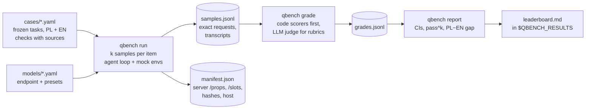

# local-llm-quality-bench

**Which open model should run your agent, in Polish *and* English? Measured, not vibed.**

[](LICENSE)


A quality-evaluation bench for **locally served open models** (llama.cpp, llama-swap, vLLM,
SGLang, Ollama, LM Studio: anything that speaks the OpenAI chat API). It grades what matters for
**agents and personal assistants**: calling the right tool with the right arguments, finishing
multi-step tasks in a mock calendar and mailbox, shopping on a frozen copy of the web, following
instructions to the letter, and writing well, in Polish and English.

Every result is a **pair**: the graded answer, plus a complete record of how it was produced (model
file, server build, chat-template hash, every sampler, the seed and the exact request body). An
outsider can reproduce any single number on their own machine.

> 📊 **Results** from the reference rig (4× Radeon AI PRO R9700, llama.cpp + llama-swap) live in their own
> repo, **[local-llm-bench-results](https://github.com/michal-konik-human/local-llm-bench-results)**: the
> leaderboard, every transcript, and quality next to speed. This repo is just the tool, so you can point it at
> your own models and keep your own results.

```bash
git clone https://github.com/michal-konik-human/local-llm-quality-bench.git && cd local-llm-quality-bench
python3 -m qbench run --model gpt-oss-20b --k 3           # generate: 115 items x 3 samples
python3 -m qbench grade runs/<run-id>                     # score: code checks + LLM judge
python3 -m qbench report runs/<run-id> --publish          # report.md + leaderboard.md in $QBENCH_RESULTS
```

Speed is measured by the sibling repo **[local-llm-perf-bench](https://github.com/michal-konik-human/local-llm-perf-bench)**
on the same machine and the same serving stack. Quality and speed together answer *which model,
at which settings, for which job*.

---

## Project map

Four repos, one job each:

| Repo | What it is | It changes when… |
|---|---|---|
| [local-llm-perf-bench](https://github.com/michal-konik-human/local-llm-perf-bench) | **Tool**: how fast a model runs (llama.cpp, any GGUF, 1–n GPUs) | the way speed is measured changes |
| [local-llm-quality-bench](https://github.com/michal-konik-human/local-llm-quality-bench) | **Tool**: how good a model is as an agent/assistant, in Polish and English | cases, scorers or model profiles change |
| [local-llm-bench-results](https://github.com/michal-konik-human/local-llm-bench-results) | **Data**: everything measured on the reference rig, quality next to speed | a benchmark run finishes |
| [radeon-r9700-rocm-notes](https://github.com/michal-konik-human/radeon-r9700-rocm-notes) | **Platform**: making 4× Radeon AI PRO R9700 + ROCm work (setup, traps, monitoring, tuning) | hardware, drivers or the serving stack change, or a new trap is found |

## Why another eval?

Public leaderboards answer a different question. They test a model in the vendor's precision, through
the vendor's API, with the vendor's settings, in English. The thing you actually run is a 3-bit quant
behind llama.cpp, with a chat template that may or may not parse tool calls, answering Polish users.
Each of those layers can break a model that tops a leaderboard:

- a quantised model that drops Polish diacritics (`Łódź` becomes `Lodz` inside a tool argument);
- a chat template that cannot emit parallel tool calls;
- a server that silently applies `top_k=40, min_p=0.05` because your client didn't send them;
- an assistant that invents an e-mail address instead of asking for one.

This bench tests **the stack you serve**, records **what the server actually did**, and keeps
**Polish and English separate**, because a Polish assistant that answers in English has failed.

## What makes it different

| | |
|---|---|
| 🧾 **Every result is replicable** | Each sample stores the exact request body. The run manifest stores the server's own `/props` (build, model file, chat-template sha256) and the samplers it *actually used* (`/slots`), diffed against what was sent. `qbench replay` re-sends any single request. |
| 🇵🇱🇬🇧 **Bilingual by design** | 55 tasks written in both languages (a paired PL−EN gap), 4 Polish-only (formal *Pan/Pani* register, gender agreement, *2 pliki / 5 plików*, Polish money and date formats) and 1 English-only. Scores are never pooled across languages. |
| 🤖 **Agents graded by outcome** | A mock calendar, mailbox, contacts, notes and to-do workspace: the final *state* is compared with the goal state, τ-bench style. Did the meeting move, were both attendees notified, was nothing deleted without confirmation? |
| 🛒 **A frozen web** | "Find the cheapest offer" over a fictional 29-page snapshot with traps: delivery costs, used and refurbished items, out-of-stock offers, a wrong variant visible only on the page, stale price-comparison data, EUR prices, a discount code. Live prices change hourly; these never do. |
| ✅ **Code first, judge second** | 56 of 60 tasks are graded entirely by deterministic code: tool-call ASTs, environment state, JSON schema, IFEval-style checks with Polish-aware counting, hidden unit tests. The LLM judge only grades writing quality, with a weighted checklist, and **never grades its own model family**. |
| 📊 **Honest statistics** | k samples per item, 95% cluster-bootstrap CIs (PL+EN twins resampled together), **pass^k** (the chance that *all* k attempts succeed) as the reliability metric, paired comparisons between configs. |
| 🔌 **Any open model** | A model is a ~20-line YAML profile: endpoint plus presets that cite where each setting comes from. Nothing in the engine knows about specific models. |

The methodology follows published guidance from Anthropic, OpenAI, Google, AWS, Microsoft,
HELM, EleutherAI, Hugging Face, UK AISI Inspect, LMSYS, BFCL and τ-bench, plus Polish eval
work from SpeakLeash and PLCC. Each rule is mapped to its source in [docs/METHODOLOGY.md](docs/METHODOLOGY.md).

## How it works



**Generate once, grade many times.** Samples are immutable, so you can re-grade with a
different judge, or after fixing a scorer, without re-running a single model.

## The suite (v1)

| Family | Tasks | What it tests | Graded by |
|---|---:|---|---|
| **Tool calling** | 14 | right tool and arguments, diacritics kept in arguments, inflected → base forms (*Grzegorza Brzęczyszczykiewicza* → *Grzegorz Brzęczyszczykiewicz*), relative dates, decimal commas, nested arguments, **no tool when none fits**, **asking when an argument is missing**, refusing what a policy forbids | tool-call AST |
| **Agentic** | 8 | multi-step assistant work in a mock workspace: reschedule and notify, find a free slot, inbox → to-dos, *Kasia from HR* → the right Katarzyna, ask when two Tomasz work in IT, never book on a weekend, never bulk-delete without confirmation | final environment state |
| **Web shopping** | 6 | cheapest real offer on a frozen web: total cost, variants, currency conversion, coupons, price per kg, and a product that doesn't exist | the final `CHOICE:` line |
| **Instruction following** | 12 | word, sentence and bullet counts (Polish abbreviations don't end sentences), JSON only, forbidden words in all inflected forms, start/end phrases, answering in the user's language, system prompt beats user | IFEval-style code checks |
| **Writing** | 10 | customer email in formal Polish, grounded summary, RAG with and without the answer in the document, plain-language rewrite, Polish register, gender agreement, numeral declension, Polish formats | code checks + rubric judge |
| **Reasoning** | 6 | percentages and VAT, calendar arithmetic, logic, units, times, a false premise | exact / numeric answer line |
| **Coding** | 4 | PESEL validator, Polish money formatting, interval merge, Unicode word counts | hidden unit tests in a sandbox |

Plus a **held-out split** (`cases-private/`, not published, hashes in `cases-private.sha256`) to
detect contamination, and a canary string in every public case.

## What one test looks like

A case (abridged) from `cases/tool_calling/tool-weather-diacritics.yaml`:

```yaml
item_type: parallel
langs:
  pl: {system: "Dzisiaj jest czwartek, 8 października 2026 r.", messages: [{role: user, content: "Jaka będzie jutro pogoda w Łodzi?"}]}
  en: {system: "Today is Thursday, 8 October 2026.",            messages: [{role: user, content: "What will the weather be like in Łódź tomorrow?"}]}
checks:
  - scorer: tool_call
    source: "Tomorrow = 2026-10-09; the city keeps its diacritics."
    expected: {calls: [{name: get_weather, args: {city: {pl: {regex: "^Łódź$"}, en: {regex: "^(Łódź|Lodz)$"}}, date: "2026-10-09"}}]}
```

And its result, one line of `results/<run>/samples.jsonl` + `grades.jsonl` (abridged):

```json
{"case": "tool-weather-diacritics", "case_sha256": "…", "lang": "pl", "sample": 0, "seed": 1873325004,
 "model": "gpt-oss-20b", "preset": "recommended",
 "request": {"model": "gpt-oss-20b", "temperature": 1.0, "top_p": 1.0, "top_k": 0, "min_p": 0.0,
             "repeat_penalty": 1.0, "presence_penalty": 0.0, "frequency_penalty": 0.0, "seed": 1873325004,
             "cache_prompt": false, "max_tokens": 6144, "messages": ["…"], "tools": ["…"],
             "chat_template_kwargs": {"reasoning_effort": "medium"}},
 "final": {"tool_calls": [{"name": "get_weather", "arguments": {"city": "Łódź", "date": "2026-10-09"}}], "tool_parse": "native"},
 "checks": [{"scorer": "tool_call", "score": 1.0, "passed": true, "detail": "get_weather: args ok"}]}
```

## Run it on your models

```bash
cp models/_example-vllm.yaml models/my-model.yaml   # endpoint + presets (cite your sources)
python3 -m qbench validate                          # schema-check cases and profiles
python3 -m qbench run --model my-model --k 3         # add --lang pl, --family agentic, --case <id> to slice
python3 -m qbench grade runs/<run-id>                # judges from judges/default.yaml
python3 -m qbench report runs/<run-id> --publish
python3 -m qbench compare runs/<A> runs/<B>          # paired difference with CI, per language and family
```

Scratch runs go to `./runs`. Published runs and the leaderboard go to `$QBENCH_RESULTS` (default
`./results`, git-ignored). Point it at a repo of your own, e.g.
`export QBENCH_RESULTS=~/my-llm-results/quality`, and share that repo.

Requirements: Python 3.10+ and PyYAML. No GPU code, no framework. The engine is ~3k lines of
stdlib Python that you can read in an afternoon, with 47 unit tests (`python3 -m unittest discover -s tests`).

The judge is configured in `judges/default.yaml`: a preference list of model profiles, local or hosted.
The reference setup uses two local judges, DeepSeek-V4-Flash-0731 and gpt-oss-120b, so nothing leaves
the machine. Before trusting a new judge, calibrate it against your own labels:
`qbench calibrate export runs/<run>`, fill in the form, then `qbench calibrate import <form>`.

## Documentation

| Doc | For |
|---|---|
| [docs/METHODOLOGY.md](docs/METHODOLOGY.md) | Why each design choice, and which published guidance it follows |
| [docs/WRITING-CASES.md](docs/WRITING-CASES.md) | Case schema, every scorer, environments, the freeze checklist |
| [docs/REPLICATE.md](docs/REPLICATE.md) | Reproduce one sample by hand, or a whole run on your machine |
| [docs/AGENT-PLAYBOOK.md](docs/AGENT-PLAYBOOK.md) | System prompt for a small model that runs evaluations for you |
| [CONTRIBUTING.md](CONTRIBUTING.md) | Good first contributions, ground rules, dev setup |
| [local-llm-bench-results](https://github.com/michal-konik-human/local-llm-bench-results) | The reference rig's published runs and leaderboard |

## Limitations, stated plainly

- **60 tasks is a screening suite.** It separates a good configuration from a bad one, not two good
  ones a few points apart. Overlapping CIs mean "not distinguishable at this size".
- **The Polish items await native-speaker review.** Every case ships as `review: pending-owner`,
  and reports say how many are still pending.
- **The judge is not yet calibrated against human labels** on the published runs. Rubric checks
  are 4 of 60 tasks; everything else is deterministic.
- **No simulated user yet.** Agent tasks are one user turn plus tool turns.
- **The coding sandbox** is a guard against accidents, not a security boundary.

## Roadmap: help wanted

- [ ] **Native-speaker review of the Polish cases.** All 59 PL items are `pending-owner`; reviewing one takes about 5 minutes.
- [ ] **Judge calibration data.** Human labels in PL and EN (`qbench calibrate export`), to publish judge–human agreement.
- [ ] **More cases**, especially multi-turn agent tasks, RAG over longer documents, and Polish public-administration tasks.
- [ ] **A simulated user** for multi-turn agent tasks (τ-bench style), with the simulator recorded in the manifest.
- [ ] **More languages**: the case format is generic; counting rules and register checks need a section per language.
- [ ] **Runs on other stacks** (vLLM, SGLang, Ollama, NVIDIA, Apple Silicon) to check that scores reproduce across them.

## Contributing

Contributions are very welcome, and you don't need to touch the engine. The most valuable are
**cases** (especially native Polish ones), **reviews of the existing Polish cases**, **model profiles**
and **runs on models or hardware I don't have**. Start with [CONTRIBUTING.md](CONTRIBUTING.md); issue
templates exist for wrong grades, case ideas and shared results. If your numbers on the same weights
fall outside my CIs, please open an issue: that is a finding about the serving stack, and worth knowing.

## Citation

If you use the bench or its cases, please cite it (GitHub's "Cite this repository" button uses
[CITATION.cff](CITATION.cff)):

```bibtex
@software{konik_local_llm_quality_bench_2026,
  author = {Konik, Michał},
  title  = {local-llm-quality-bench: bilingual (Polish/English) quality evals for locally served LLMs},
  year   = {2026},
  url    = {https://github.com/michal-konik-human/local-llm-quality-bench}
}
```

## License

**MIT** for the code *and* the cases: use them, fork them, ship them in your own eval suite. The cases
are fictional (shops under the reserved `.example` domain, invented people and companies); any
resemblance to real ones is accidental. The held-out split (`cases-private/`) is intentionally not
published.
